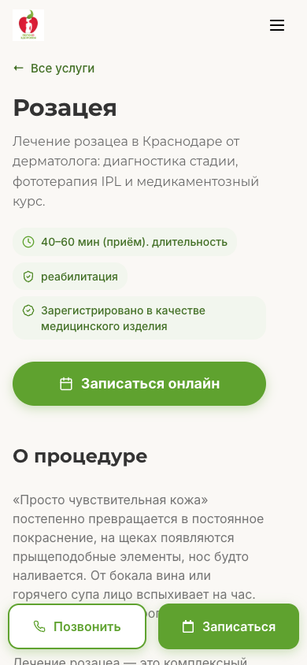

# Мобильные пустые промежутки — проверка и исправления

Дата: 22.10.2026. Цель: только `https://new.yaclinic.ru/`.

## Итог

Подтверждённые ошибки промежутков исправлены на стенде. Создан и активирован сниппет **57**. После перезагрузки редактора его код экспортирован и побайтно сверен с подготовленным кодом после исключения служебного заголовка экспорта. Production, DNS и закрытая preflight-копия не менялись.

| Место | До, 390 px | После публикации, 390 px |
|---|---:|---:|
| Розацея: пустой промо-контейнер | 322.19 px высоты | 0 px, контейнер скрыт |
| Грачева: видимый интервал от фото до заголовка специализации | 251.78 px | 151.78 px |
| Общий шаблон врачей: нижний padding результатов + следующий margin + верхний padding специализации | 50 + 80 + 50 = 180 px | 24 + 32 + 24 = 80 px |

У Розацеи отсутствует `hero_media`, а ссылка видео пуста. Декоративная иконка не считается медиа. Убирается только подтверждённая пустая мобильная рамка страницы 2403, а не все промо-блоки сайта. Если настроено ACF-медиа, проверка не скрывает ожидающую lazy loading картинку. Настоящие фоновые фото, изображения, плееры и непустые ссылки видео сохраняются.

Правка отступов действует только на мобильной ширине до 767 px и только на двух соседних секциях общего шаблона врачей 1077. Она применяется ко всем 9 профилям. На ширине 768 px и выше существующие отступы сохранены. Тексты, цены, карточки, файлы, связи врачей и порядок галерей не изменялись.

## Охват

Публичный список получен через доступные WordPress REST-коллекции и ссылки навигации. XML sitemap стенда недоступен; его настройки не менялись.

- 219 адресов проверены в реальном анонимном Chromium на ширине 390×844; после повторов все дали конечный HTTP 200.
- Это **193 разных конечных страницы и 26 адресов, перенаправляющих на главную**, а не 219 самостоятельных страниц.
- В охват входят 41 страница услуг, 9 профилей врачей, 75 статей, 51 страница документов, основные страницы и разделы навигации. Старые адреса акций, отзывов и аппаратов учтены с их фактическими переходами.
- Отдельно проверены все 539 URL позиций прайса: первый ответ HEAD у каждого — 301 на `/price/`. Эти URL не выдаются за 539 разных макетов. Сам прайс проверен в браузере.
- При обходе дождались шрифтов, прокрутили каждую успешно открытую страницу до конца, учли скрытие элементов, обрезку и shadow DOM отзывов.
- Автоматический сигнал: вертикальная полоса без видимого содержимого более 240 px или лишняя высота обёртки более 240 px. Это поиск кандидатов, а не автоматическое решение удалять отступы.
- На конечных страницах не найдено горизонтального переполнения страницы. Максимальный замеренный переход от содержимого main до footer — 162.31 px; повторения прежней пустоты после отзывов не обнаружено.

## Классификация остальных кандидатов

1. Главная: 269.63 px между концом содержимого карточки аппарата и следующим заголовком. Проверено визуально: это совокупность заданных отступов секций, не пустой виджет и не зависшая высота отзывов. Сохранено без редизайна.
2. `/private-police/`: 316.53 px внутри строки юридической таблицы. Соседние столбцы содержат текст, задающий высоту строки; таблица прокручивается горизонтально. Высота не уменьшалась, текст не обрезался.
3. `/dokumenty/politika-obrabotki-personalnyh-dannyh/`: 302.53 px того же типа. Подтверждены overflow-x:auto на таблице и содержимое соседних ячеек. Сохранено.
4. Розацея: подтверждённая пустая рамка — исправлена.
5. Грачева: сложение больших отступов общего шаблона — исправлено в мобильном шаблоне врачей.

## Проверка после публикации

- Все 9 профилей и Розацея повторно пройдены сканером на 390 px: 10/10 HTTP 200, нет кандидатов пустот >240 px и переполнения.
- Розацея и Грачева дополнительно проверены на 360, 414, 767, 768 и 1440 px: 10/10 загрузок с подвалом, без переполнения; правило включается только на мобильном breakpoint.
- На 6 страницах с настоящим промо-медиа проверено сохранение изображения/видео и размеров: Биоревитализация, Чистка лица, Диетолог, Фотоомоложение, Смас-лифтинг, Термолифтинг.
- У Грачевой на 390 и 1440 px: фото 1 → фото 2 → видео 3 в исходном порядке; видео 600×600 воспроизводится, currentTime растёт; просмотрщик закрывается кнопкой на мобильной ширине и Escape на настольной.
- На обеих ширинах форма записи открылась, загрузилась до заголовка «Запись на приём» и закрылась. Заявки не отправлялись. Первичный асинхронный загрузочный экран не считался готовой формой.
- 15 локальных проверок защиты медиа и границ кода — PASS. Отдельная проверка сохранённых результатов и совпадения кода — PASS.
- В браузерном предпросмотре настольная геометрия до/после совпала. Видимый текст и атрибуты медиа профиля совпали; у Розацеи скрыта только подпись пустого промо.

## Ограничения и отдельный риск

Это браузерная эмуляция размеров Chromium, а не испытание физических iPhone/Android и не отдельный прогон Safari. Не перебирались все комбинации параметров поиска и фильтров. Проверка касается пустых промежутков, а не полного медицинского, SEO или релизного аудита.

В начальном обходе были таймауты прайса и старого адреса акции; успешные повторы сохранены отдельно. До активации правки при открытии Розацеи в новой изолированной сессии также зарегистрирован `ERR_INCOMPLETE_CHUNKED_ENCODING` — сервер обрывал HTML. Затем браузерный предпросмотр и все опубликованные проверки этой страницы прошли с полным подвалом. Причина серверного обрыва этим CSS/JS-исправлением не устранялась; это отдельный риск стабильности, не скрытый положительным результатом повторов.

## Код, откат и граница переноса

- `mobile-spacing.php` — установленный исходный код.
- `snippet57-active-readback.php` — экспорт после активации и reload.
- Откат: деактивировать только сниппет 57. Восстановление БД для этой правки не нужно.
- Код содержит явную проверку host `new.yaclinic.ru`. Это не автоматическое применение на будущий основной домен. Его перенос требует отдельного решения в пакете релиза.
- Подробные результаты: `effective-coverage.json`, `mobile-after-affected.json`, `responsive-after.json`, `media-regression.json`, `functional-after.json`, `price-route-validation.json`.

Скриншоты профиля и галереи сохранены локально. В GitHub они не включены, чтобы не создавать дополнительные копии изображений пациентов.
